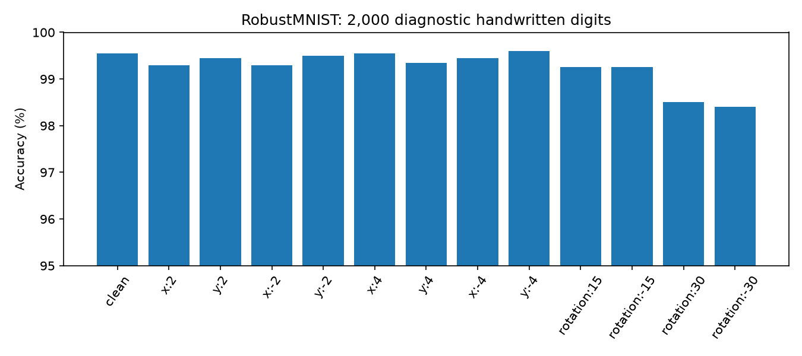
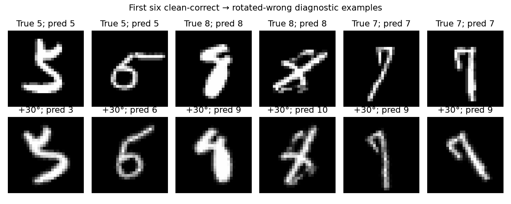

# RobustMNIST: testing a published 455,991-parameter model

We independently tested [MultivexAI/RobustMNIST-v1.0](https://huggingface.co/MultivexAI/RobustMNIST-v1.0)
on real MNIST handwritten digits. The model card reports 99.51% clean accuracy
and warns about geometric distortions. **We reproduced strong clean accuracy;
the tested distortions did not reproduce a large enough failure to justify surgery.**
No weight edit, causal localization, training, or backward pass was performed.

## Frozen experiment

Revision `6742662f0e48a88b7d069d2094d211f8fd106d5a`; checkpoint SHA-256
`9fb6645f700d0bcc50cd76f6ec8b31e031d777fe8634b85d2a162406eee482d7`.
The downloaded architecture was inspected before execution and its hash is checked
by the runner. Upstream architecture and weights are Apache-2.0; they are downloaded
separately, not redistributed or relicensed by this MIT skill repository.

CPU PyTorch 2.15.0, float32, eval mode, two threads, seed 2026. Inputs follow the
publisher's `[0,1]` convention. The checkpoint audit found no sampled nonfinite
values; see its explicit sampling coverage in the linked results.

MNIST test source IDs were partitioned into 2,000 diagnostic, 2,000 development,
and 6,000 sealed examples. All variants of one source stay in one partition.
Development data remained unused because the diagnostic gate failed. Training-data
provenance is incomplete, so these splits prevent investigator tuning but cannot
prove independence from the publisher's original training/evaluation choices.

The predeclared gate required 50 clean-correct → transformed-wrong diagnostic
examples in one condition. We tested ±2/±4 pixel translations on both axes,
then ±15° rotations and the predeclared ±30° extension. No condition reached
50; ±30° each produced 23 new errors. No threshold was changed after seeing results.
Translations zero-pad without wrapping; rotations use bilinear grid sampling,
zero padding and `align_corners=False`. Cropping/interpolation may contribute
to individual errors; these images alone establish no internal mechanism. Several
rotated samples are visually ambiguous (for example, a rotated 7 resembles a 9),
which further limits interpretation of their original labels as a clean causal target.





## Sealed evaluation

After freezing the negative verdict, we measured clean and the two fixed ±30°
conditions on the sealed images. We did not select a new target or tune on them.

| Condition | Correct / 6,000 | Accuracy |
|---|---:|---:|
| Clean | 5,970 | 99.50% |
| +30° sampling rotation | 5,924 | 98.73% |
| −30° sampling rotation | 5,900 | 98.33% |

No wrong digit prediction reached the fixed 90% softmax-confidence threshold in
these conditions. This describes that threshold and dataset, not general calibration.
The maximum possible accuracy gain here is below the predeclared five-point
repair requirement, providing another reason not to attempt a repair in this case.

The model rejected **67.10% of 2,000 Fashion-MNIST test images** as Unknown.
The remaining garments were assigned digit classes. This is an additional OOD
observation, not a matched reproduction of the publisher's unspecified “extreme
OOD” set and not a claim of confident OOD errors. It is a useful separate follow-up.

## What the skill demonstrated

The skill completed checkpoint forensics, respected diagnostic/sealed separation,
kept the original model state unchanged, and stopped at its evidence gate.
The competing internal explanations (preprocessing, gates, pooling, classifier)
remain untested. A weight patch, random edit controls, centering comparisons,
causal attribution and repair uncertainty intervals are **not applicable** because
no repair candidate was developed. This is one investigator's public-model case,
not a blind agent benchmark or evidence that sparse editing works on real models.

The measured reproduction/evaluation phases took about 219 seconds, excluding
setup, plotting and downloads. Reconstruction and evaluation processed 46,000 image
instances in 730 forward batches; plotting used another 4,000 diagnostic instances
in 64 batches. The initial reproduction counts were reconstructed from batch sizes,
not instrumented. All backward-pass counts are zero. Peak process memory was not
instrumented; it must not be inferred from these counts.

## Reproduce

From the repository root, install `requirements.txt`, then run:

```bash
python examples/robustmnist_case.py --phase reproduce
python examples/robustmnist_case.py --phase investigate
python examples/robustmnist_case.py --phase evaluate
```

Defaults cache downloads in `/tmp/robustmnist-case` and write results under ignored
`reports/robustmnist`. Override `--cache-dir` and `--output` as needed. Downloads
include model weights, the reviewed architecture, and official MNIST/Fashion-MNIST
test IDX files. No model training is required. Ordinary CI never downloads them.

To regenerate the figures, install matplotlib, copy the reproduction JSON to
`examples/robustmnist/`, then run `python examples/plot_robustmnist.py`. Plotting
loads the same model and uses diagnostic examples only.

Machine-readable [reproduction](robustmnist/reproduction.json),
[evaluation](robustmnist/evaluation.json), [audit](robustmnist/audit.json),
[stopping decision](robustmnist/investigation.json), and
[artifact hashes](robustmnist/provenance.json) accompany this report.
