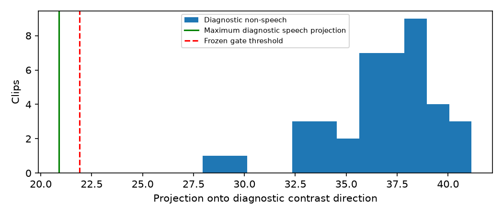
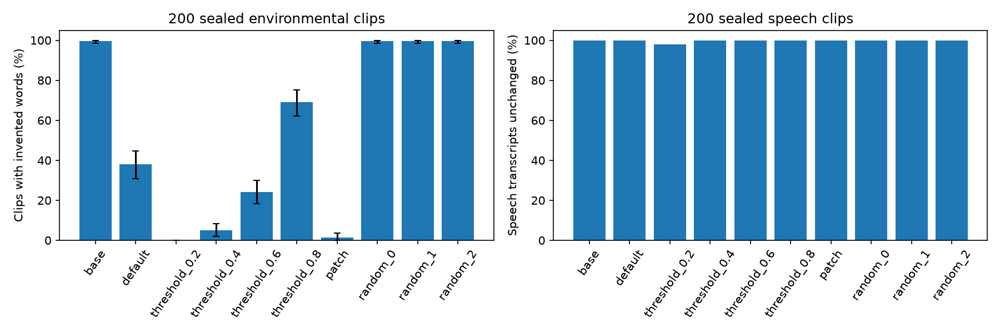

# Reproducing an existing Whisper neuron-gate repair

**Codex found this repair method in [Kevin Bondzio’s published work](https://github.com/kevinpl07/weight-patching/tree/d7df0d9bd15afb952b1e0cb64a067806563aa8e3)
and adapted it. It did not independently discover the fix.** This is a reproduction
with implementation and evaluation refinements. No significant new repair method
or methodological advance has been established by this run.

**A measured reproduction on a real pretrained speech model, for $0.0280.** On 200 sealed environmental recordings, the default no-speech rule produced words for 76 clips (38%); applying the adapted published method reduced that to 3 clips (1.5%). All 200 genuine-speech transcripts remained byte-identical, and WER stayed at 4.304%.

The patch changes **1,537 of 241,734,912 parameters (0.000636%)**. It passed the predeclared repair and preservation gates. The paired improvement over the default rule was 36.5 percentage points, with a source-recording bootstrap 95% interval of **29.4–43.6 points** (2,000 replicates, seed 2026).

## Contribution audit

| Component | Origin and significance |
|---|---|
| Speech/non-speech activation contrast, low-usage neuron selection, threshold gate and period-token write | Existing upstream repair recipe; not discovered by Codex |
| Decoder, normalization and supporting helpers | Substantially copied: 276 of 279 upstream helper lines were unchanged in the measured implementation; local changes added attribution, immutable revision pins and safetensors loading |
| Held-out evaluation, decoding baselines, speech-preservation checks and random controls | Already present upstream; not methodological contributions of this project |
| Data preparation and splits | Our smaller sample and augmentation setup using the same source corpora; a separate evaluation, not a new benchmark |
| Threshold/strength sweep and random edits matched on actual delta norms | Limited implementation refinements; no isolated experiment establishes that they improve the upstream method |
| Parity/reload checks, source-group intervals, artefact verification and cost accounting | Additional checks in this reproduction; not new scientific techniques |
| Agent Skill integration and documentation | Useful engineering packaging; does not establish general autonomous debugging or discovery ability |

The substantive value is a runnable reproduction and additional measurements on a
different, smaller sample. We did not perform a controlled comparison with the
upstream implementation on identical data, nor a blind investigator benchmark.
The upstream study already reports successful Whisper repair and tests a broader
speech-preservation suite. Our numbers cannot establish superior accuracy,
robustness, efficiency, or a new mechanism. The low cost is an observation from
this run, not evidence of an improvement over upstream.

## Application of the borrowed method

In decoder layer 11, neuron 304 reads a diagnostic speech/non-speech contrast direction. We replace its `fc1` row with that unit direction, its bias with −21.9025268555, and its `fc2` column with a gain-2 direction toward the period token, adjusted for final LayerNorm scaling. The neuron was selected by low diagnostic usage. It provides a conditional write when the non-speech signal exceeds the threshold.

The target is the period token: successful raw non-speech outputs typically become `.` and then terminate. They are **not literally empty strings**; the speech normalizer removes punctuation, leaving no invented words. Speech preservation was checked on raw strings as well as normalized text.



## Held-out results

| Method | Non-speech with words | Speech unchanged | WER |
|---|---:|---:|---:|
| Raw greedy decoder | 99.5% | 100.0% | 4.304% |
| Default no-speech rule, one greedy pass | 38.0% | 100.0% | 4.304% |
| Threshold 0.2 | 0.0% | 98.0% | 5.302% |
| Threshold 0.4 | 5.0% | 100.0% | 4.304% |
| One-neuron patch | 1.5% | 100.0% | 4.304% |
| Matched random edit 0 | 99.5% | 100.0% | 4.304% |
| Matched random edit 1 | 99.5% | 100.0% | 4.304% |
| Matched random edit 2 | 99.5% | 100.0% | 4.304% |

Each column uses 200 clips. Threshold configurations were prespecified and screened on development data, not selected using these test scores. The aggressive 0.2 rule suppresses all non-speech outputs but drops four genuine utterances and fails the preservation gates. The 0.4 comparison preserves speech but leaves ten environmental clips with words. This study does not compare every VAD or production ASR pipeline.



## Example outputs

These are illustrative repaired test cases, not the sample used to estimate the rates. Audio links point to the original ESC-50 recordings; audio is not redistributed here.

| Input | Before (raw decoder) | After |
|---|---|---|
| [toilet_flush](https://github.com/karolpiczak/ESC-50/blob/master/audio/4-145006-A-18.wav) | `I` | `.` |
| [crackling_fire](https://github.com/karolpiczak/ESC-50/blob/master/audio/3-158476-A-12.wav) | `That's perfect.` | `.` |
| [vacuum_cleaner](https://github.com/karolpiczak/ESC-50/blob/master/audio/5-263902-A-36.wav) | `I` | `.` |
| [chirping_birds](https://github.com/karolpiczak/ESC-50/blob/master/audio/5-257839-A-14.wav) | `you` | `.` |

## Evidence and limits

The diagnostic set contained 40 speech and 40 environmental clips. A labelled mean-activation contrast separated diagnostic non-speech inputs from speech positions. Simple ±direction activation shifts did **not** reduce the original hallucinations; sham intervention also left them unchanged. We therefore make no claim that this direction explains the complete original failure circuit. The new conditional gate and its matched random controls support the scoped claim that this deliberate parameter intervention changes the target behavior.

Nine gate configurations were evaluated on a separate 40+40 development set. One candidate was frozen before the 200+200 sealed evaluation. All three random edits matched changed-coordinate support and actual delta norms, including the bias change; all retained the raw decoder’s 99.5% failure rate. Fresh checkpoint reload and patch reapplication reproduced eight sampled outputs exactly. The working model’s edited tensors were restored afterward.

Speech guards include clean, quiet, silence-padded, and background-mixed utterances. Groups are separated by environmental source recording and LibriSpeech speaker. One cross-fold environmental source overlap was detected and replaced before inference; no speech guard used the removed recording as background. These are finite samples, not a guarantee for every speaker, language, or noise condition. No ASR training or backward passes were used; labelled activation statistics and development selection were used.

## Reproduce and provenance

Base model: [openai/whisper-small](https://huggingface.co/openai/whisper-small), revision `973afd24965f72e36ca33b3055d56a652f456b4d`. GPU code revision: `a92bb0effb0b46865fa5107aa5d359841da3bc93`. PyTorch 2.5.1, Transformers 4.57.6, float32, seed 2026, RTX 3060. The measured inference workflow took 971.5 seconds; setup and result recovery are additional.

The decoder and neuron-gate recipe adapt [Kevin Bondzio’s weight-patching investigation](https://github.com/kevinpl07/weight-patching), pinned to `d7df0d9bd15afb952b1e0cb64a067806563aa8e3`, under the [upstream MIT license](whisper/UPSTREAM-LICENSE). This is an independent adaptation and evaluation, not a blind discovery or a novel repair algorithm. The broader inspiration is [Weight-Space Programming](https://rikiyat.github.io/blog/weight-space-programming/).

Data: [ESC-50](https://github.com/karolpiczak/ESC-50) environmental classes excluding human vocal/non-speech categories, and [LibriSpeech](https://www.openslr.org/12) development/test speech. Respect their respective licences; this repository does not relicense their recordings.

Install the repository requirements plus `transformers==4.57.6 scipy soundfile jiwer matplotlib`. On a machine with adequate disk, run:

```bash
python examples/whisper/prepare.py
python examples/whisper/augment.py
python examples/whisper/fix_splits.py
WHISPER_STUDY_DIR=/tmp/whisper-study python examples/whisper/run.py
python examples/whisper/summarize.py --results /tmp/whisper-study/results --output reports/whisper-summary
```

Preparation defaults to `/tmp/whisper-study`; ensure space for the archives and waveforms. For GPU execution, copy the prepared directory and set `WHISPER_STUDY_DIR` to its location. The raw run outputs and 19 MB patch are retained locally under ignored `reports/whisper-work/recovered/`; downloaded weights, recordings, and raw test sets are not committed.

Machine-readable [results and tensor footprints](whisper/results/summary.json) and [cost/recovery record](whisper/results/cost.json) accompany this report. The sole rented instance was checksum-verified, recovered, and destroyed. Total observed account-credit decrease was **$0.028023**, below the **$0.25 cap**.
